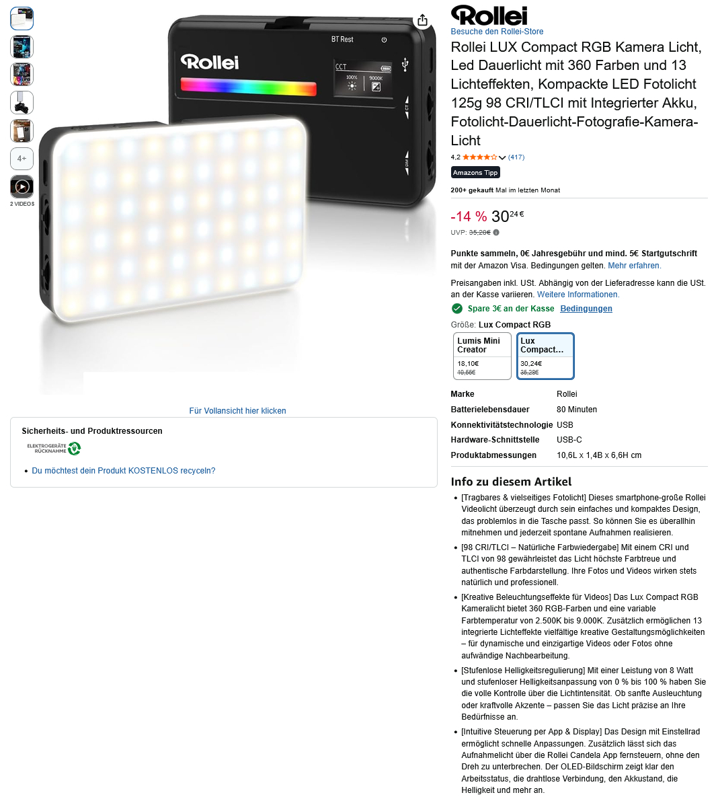

# Rollei LUX Compact RGB LED – BLE-Steuerung

Steuerung der Rollei LUX Compact RGB LED über Bluetooth Low Energy (BLE)
mit einem Raspberry Pi unter Debian Linux.

Die Kommunikation erfolgt über BLE-Advertising-Pakete.
Eine dauerhafte Bluetooth-Verbindung zur Lampe ist nicht erforderlich.

## Funktionen

- Lampe ein- und ausschalten
- Farbtemperatur (CCT) und Helligkeit einstellen
- 13 integrierte Lichteffekte steuern
- Drei Varianten pro Effekt
- Effektparameter und Helligkeit speichern
- Lampenstatus über BLE überwachen
- Automatische Initialisierung beim Systemstart

## Voraussetzungen

- Raspberry Pi mit Bluetooth LE
- Debian Linux (getestet mit Debian 13)
- Bluetooth-Adapter hci0
- Python 3
- Rollei LUX Compact RGB LED

## Installation

Repository herunterladen:

    git clone https://github.com/micronano0/rollei-lux-ble.git
    cd rollei-lux-ble

Installer starten:

    sudo bash install_rollei.sh

Bei erneuter Installation bleiben vorhandene Effekteinstellungen erhalten.
Vorhandene Rollei-Dateien werden zuvor gesichert.

## Bedienung

Lampe einschalten:

    python3 ~/rollei_effekte_auto.py on

Mit Farbtemperatur und Helligkeit:

    python3 ~/rollei_effekte_auto.py on 5600 50

Lampe ausschalten:

    python3 ~/rollei_effekte_auto.py off

Effekt mit gespeicherten Einstellungen starten:

    python3 ~/rollei_effekte_auto.py 8

Effekt mit Variante und Helligkeit starten:

    python3 ~/rollei_effekte_auto.py 8 2 50

Allgemeiner Aufruf:

    python3 ~/rollei_effekte_auto.py EFFEKT [VARIANTE] [HELLIGKEIT]

Zulässige Werte:

- Effekt: 1 bis 13
- Variante: 1, 2 oder 3
- Helligkeit: 1 bis 100 Prozent

Nicht angegebene Werte werden aus rollei_effekte.json übernommen.

## Die 13 Lichteffekte

| Nr. | Effekt |
|---|---|
| 1 | Feuer |
| 2 | Feuerwerk |
| 3 | CCT-Wechsel |
| 4 | Pulsieren |
| 5 | Leuchtfeuer |
| 6 | TV |
| 7 | Party |
| 8 | Explosion |
| 9 | Kaputte Glühbirne |
| 10 | Schweißen |
| 11 | Stroboskop |
| 12 | Blitz |
| 13 | SOS |

## Systemdienste

- rollei-auto-init.service: Initialisierung der Lampe
- rollei-monitor.service: Überwachung der BLE-Werbung

Status prüfen:

    systemctl status rollei-auto-init.service
    systemctl status rollei-monitor.service

## Konfigurationsdateien

rollei_effekte.json:
Gespeicherte Einstellungen der 13 Effekte und CCT-Steuerung.

rollei_status.json:
Dynamischer Lampenstatus des BLE-Monitors.
Diese Datei gehört nicht ins Git-Repository.

## Hinweise

Die Steuerung verwendet BLE-Advertising statt einer dauerhaften
Bluetooth-Verbindung.

Andere Bluetooth-Steuergeräte, insbesondere Smartphones,
können die Kommunikation beeinflussen.

Die Steuerfunktionen wurden auf einem Raspberry Pi mit Debian 13 getestet.
Eine vollständige Neuinstallation mit dem überarbeiteten Installer
wurde noch nicht separat getestet.

## Lizenz

Noch festzulegen.
