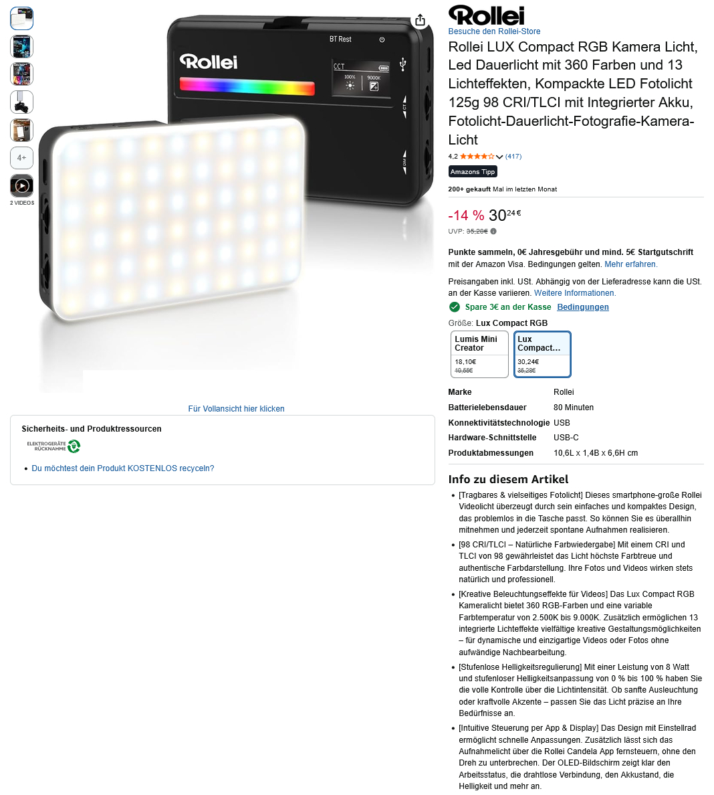

# Rollei LUX Compact RGB LED – BLE Control



Python-based Bluetooth Low Energy (BLE) control for the Rollei LUX Compact RGB LED using a Raspberry Pi.

## Features

- Wireless control via Bluetooth Low Energy
- Support for CCT, HSI and EFF modes
- Control of 13 lighting effects
- Adjustable effect speed, brightness and variants
- Automatic detection and monitoring of lighting modes
- Storage of effect parameters
- Integration with a Raspberry Pi photobooth
- Automatic startup using systemd services

## Hardware

- Rollei LUX Compact RGB LED
- Raspberry Pi 4B
- Bluetooth LE adapter (integrated or USB)

## Software

Developed and tested on:

- Raspberry Pi OS / Debian 13
- Python 3
- BlueZ Bluetooth stack
- Linux systemd

## Installation

The repository contains an installation script:

```bash
chmod +x install_rollei.sh
./install_rollei.sh
```

Review the installation script and its requirements before running it on a new system.

Additional installation instructions are available in `installationsanleitung.txt`.

## Usage

The project includes a command-line controller for 13 lighting effects.

Example:

```bash
python3 rollei_effekte_auto.py 8 2
```

This selects effect 8 (Explosion) with rate 2.

The project also contains `rollei_fotobox.py` for photobooth integration.

## Lighting effects

| No. | Effect |
|---|---|
| 1 | Feuer |
| 2 | Feuerwerk |
| 3 | CCT-Wechsel |
| 4 | Pulsieren |
| 5 | Leuchtfeuer |
| 6 | TV |
| 7 | Party |
| 8 | Explosion |
| 9 | Kaputte Glühbirne |
| 10 | Schweißen |
| 11 | Stroboskop |
| 12 | Blitz |
| 13 | SOS |

## Project files

- `rollei_effekte_auto.py` – Main effect controller
- `rollei_monitor.py` – BLE status monitoring
- `rollei_auto_init.py` – Automatic initialization
- `rollei_fotobox.py` – Photobooth integration
- `rollei_effekt_*.py` – Individual lighting effects
- `rollei-auto-init.service` – Automatic initialization service
- `rollei-monitor.service` – Monitoring service
- `install_rollei.sh` – Installation script

## Project status

Working project snapshot: **9 November 2026**.

The project is under continued development. Individual lighting effects and mode transitions may require additional testing.

## Documentation

See the included installation guide, technical documentation and system reference for further details.
